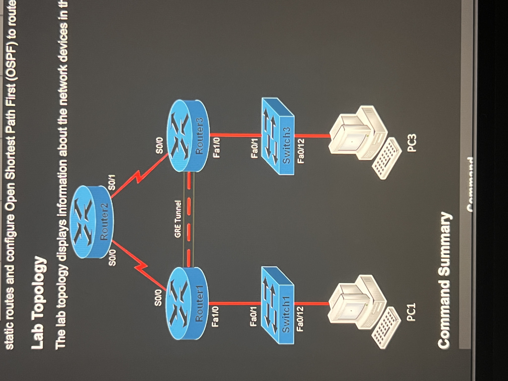
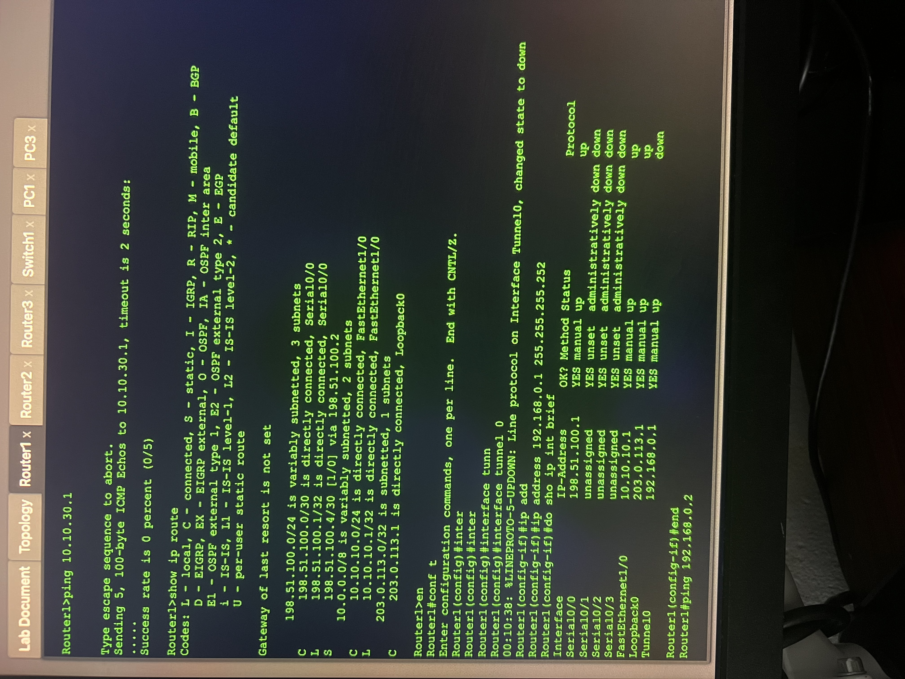
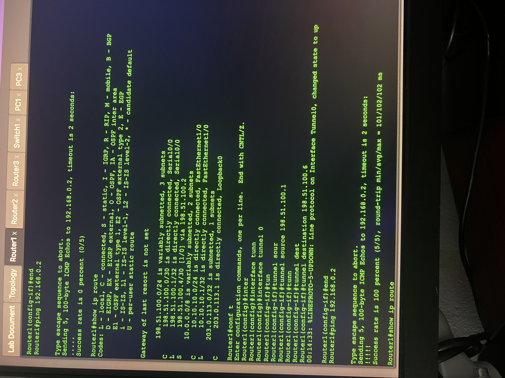
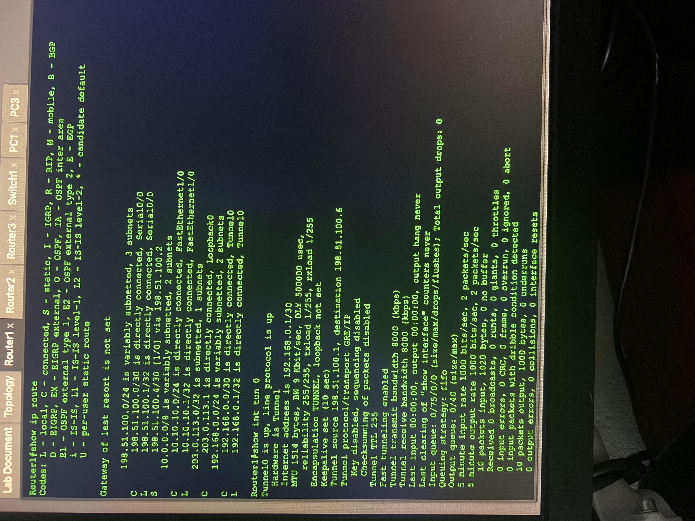
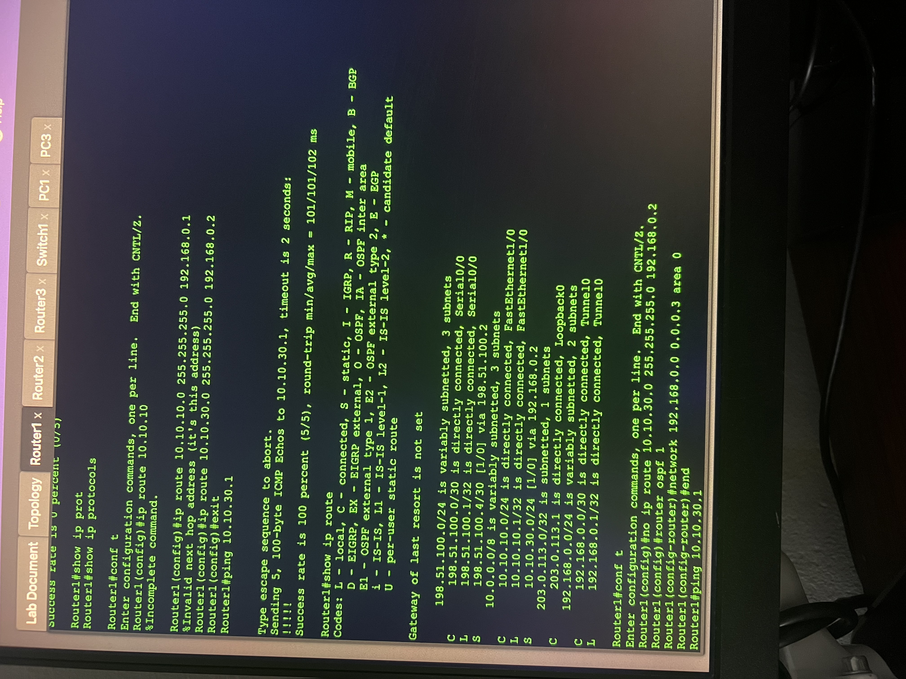
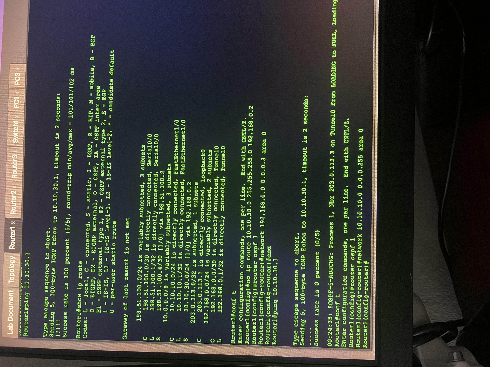
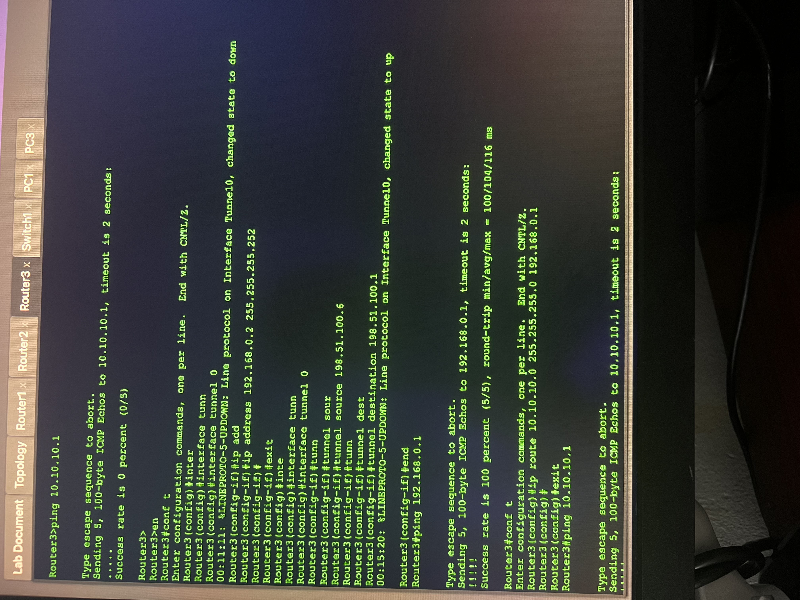
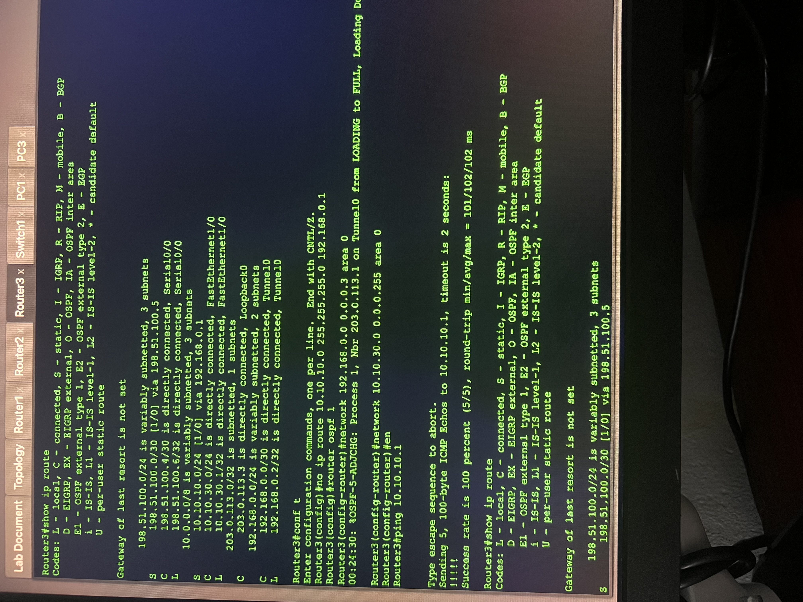
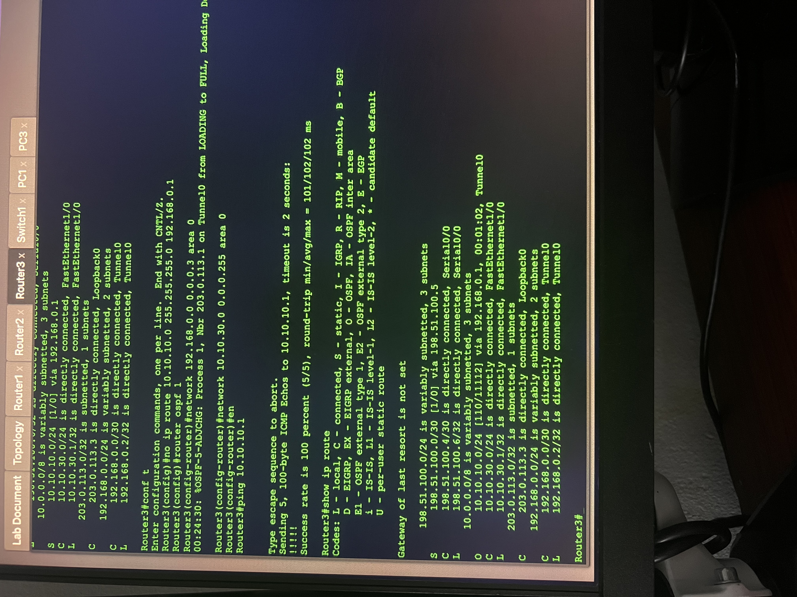
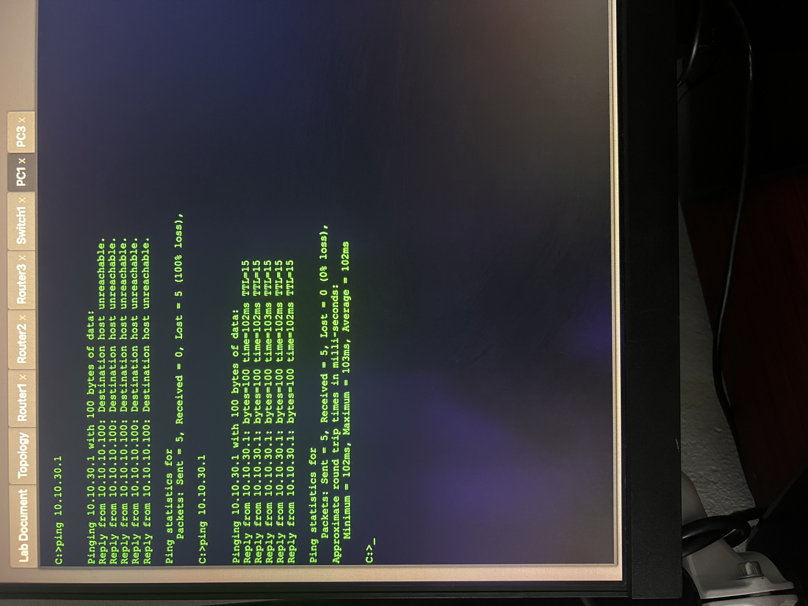

# Lab 27 – GRE Tunneling with Static Routing and OSPF

## Lab Overview

This lab demonstrates the implementation, configuration,
verification, and troubleshooting of Generic Routing
Encapsulation (GRE) tunnels across a WAN infrastructure.

A point-to-point GRE tunnel was established between
Router1 and Router3 through Router2. Static routing
was initially implemented and subsequently replaced
with OSPF dynamic routing over the GRE tunnel.

## Lab Objectives

- Configure point-to-point GRE tunneling.
- Establish underlay WAN connectivity.
- Configure logical tunnel interfaces.
- Configure tunnel source and destination addresses.
- Implement static routing over GRE.
- Implement OSPF Area 0 over GRE.
- Establish OSPF neighbor adjacency.
- Verify dynamic route advertisement.
- Troubleshoot tunnel and routing failures.
- Verify remote network connectivity.

## Technologies Used

- Cisco IOS
- GRE (Generic Routing Encapsulation)
- Static Routing
- OSPFv2
- IPv4 Addressing
- WAN Connectivity
- IP Encapsulation
- ICMP
- Layer 3 Routing
- Overlay and Underlay Networking

## Network Topology

                    Router2
                   /       \
                  /         \
             Router1       Router3
                 |===========|
                 | GRE Tunnel|
                 |           |
              Switch1     Switch3
                 |           |
                PC1         PC3

Router2 provides the underlying WAN transport,
while Router1 and Router3 establish a logical
point-to-point GRE tunnel.

## IP Addressing Table

| Device | Interface | IP Address |
|---|---|---|
| Router1 | Serial0/0 | 198.51.100.1/30 |
| Router2 | Serial0/0 | 198.51.100.2/30 |
| Router2 | Serial0/1 | 198.51.100.5/30 |
| Router3 | Serial0/0 | 198.51.100.6/30 |
| Router1 | FastEthernet1/0 | 10.10.10.1/24 |
| Router3 | FastEthernet1/0 | 10.10.30.1/24 |
| Router1 | Tunnel0 | 192.168.0.1/30 |
| Router3 | Tunnel0 | 192.168.0.2/30 |
| Router1 | Loopback0 | 203.0.113.1/32 |
| Router3 | Loopback0 | 203.0.113.3/32 |

## Phase 1 – Underlay Static Routing

### Router1

```cisco
configure terminal
ip route 198.51.100.4 255.255.255.252 198.51.100.2
end
```

### Router3

```cisco
configure terminal
ip route 198.51.100.0 255.255.255.252 198.51.100.5
end
```

These routes provide reachability between the
physical GRE tunnel endpoints through Router2.

## Phase 2 – GRE Tunnel Configuration

### Router1

```cisco
configure terminal
interface tunnel 0
 ip address 192.168.0.1 255.255.255.252
 tunnel source 198.51.100.1
 tunnel destination 198.51.100.6
 no shutdown
end
```

### Router3

```cisco
configure terminal
interface tunnel 0
 ip address 192.168.0.2 255.255.255.252
 tunnel source 198.51.100.6
 tunnel destination 198.51.100.1
 no shutdown
end
```

## Phase 3 – Static Routing over GRE

### Router1

```cisco
configure terminal
ip route 10.10.30.0 255.255.255.0 192.168.0.2
end
```

### Router3

```cisco
configure terminal
ip route 10.10.10.0 255.255.255.0 192.168.0.1
end
```

Static routes allow communication between remote
LAN networks through the GRE tunnel.

## Phase 4 – OSPF over GRE

The overlay static routes were removed and
replaced with OSPF dynamic routing.

### Router1

```cisco
configure terminal
no ip route 10.10.30.0 255.255.255.0 192.168.0.2
router ospf 1
 network 192.168.0.0 0.0.0.3 area 0
 network 10.10.10.0 0.0.0.255 area 0
end
```

### Router3

```cisco
configure terminal
no ip route 10.10.10.0 255.255.255.0 192.168.0.1
router ospf 1
 network 192.168.0.0 0.0.0.3 area 0
 network 10.10.30.0 0.0.0.255 area 0
end
```

The underlay static routes remain in place to
maintain physical tunnel endpoint reachability.

## Phase 5 – Verification

```cisco
show ip interface brief
show interfaces tunnel 0
show ip route
show ip route ospf
show ip ospf neighbor
show ip protocols
ping 192.168.0.1
ping 192.168.0.2
ping 10.10.10.1
ping 10.10.30.1
```

## Verification Results

- GRE tunnel interface: UP/UP
- Tunnel protocol: GRE/IP
- Tunnel endpoint connectivity: 100% successful
- OSPF adjacency: FULL
- OSPF area: Area 0
- OSPF process ID: 1
- Remote LAN route learned through Tunnel0
- PC1 to Router3 LAN interface: 100% successful
- Packet loss during final PC1 test: 0%

### Observed OSPF Route on Router3

```text
O 10.10.10.0/24 [110/11112]
  via 192.168.0.1, Tunnel0
```

- O: OSPF-learned route
- 110: Administrative distance
- 11112: OSPF metric
- 192.168.0.1: Next-hop tunnel address
- Tunnel0: Outgoing logical interface

## Troubleshooting

### Issue 1 – GRE Tunnel Down

The tunnel interface was initially UP/DOWN
because its configuration was incomplete.

Resolution:
Configured the tunnel source and destination
addresses and verified endpoint reachability.

Result:
Tunnel0 transitioned to UP/UP.

### Issue 2 – Remote LAN Unreachable

The remote LAN was initially unreachable
because a route to the destination was missing.

Resolution:
Configured static routes through the remote
GRE tunnel addresses.

Result:
Remote router LAN interfaces became reachable.

### Issue 3 – Invalid Next-Hop Address

A static route was initially configured using
Router1's own tunnel IP as the next hop.

Resolution:
Replaced the incorrect route attempt with the
remote network and remote tunnel next hop.

### Issue 4 – OSPF Route Convergence

Connectivity temporarily failed after removing
the overlay static route and enabling OSPF.

Resolution:
Completed OSPF network configuration and
allowed neighbor adjacency to reach FULL.

Result:
Remote networks became reachable through OSPF.

## Lab Screenshots

### Network Topology


### Router1 Initial Tunnel Configuration


### Router1 Tunnel Establishment


### GRE Tunnel Verification


### Static Routing over GRE


### Router1 OSPF Configuration


### Router3 GRE Configuration


### Router3 OSPF Configuration


### OSPF Routing Table Verification


### PC1 Remote Connectivity Verification


## Real-World Applications

- Connecting geographically separated branch offices.
- Transporting routing protocols across WAN networks.
- Establishing logical point-to-point connections.
- Supporting enterprise overlay architectures.
- Connecting private networks over IP infrastructure.

GRE provides encapsulation but does not provide
encryption by itself. IPsec can be combined with
GRE when confidentiality is required.

## Skills Demonstrated

- GRE Tunnel Implementation
- WAN Routing and Troubleshooting
- Static and Dynamic Routing
- OSPF Neighbor Establishment
- Routing Table Analysis
- Overlay and Underlay Architecture
- Cisco IOS Configuration
- Network Connectivity Verification

## Lab Level

Intermediate / CCNP Enterprise

## Lab Status

Successfully Configured and Verified
